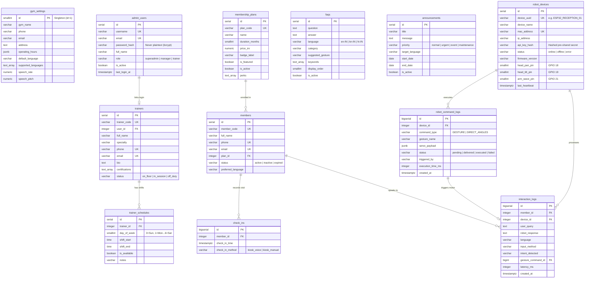

# 🐘 PostgreSQL Database Architecture: Virtex AI Gym Receptionist Robot

This directory contains the complete database schema, security rules, seed records, and example production SQL queries for the Gym Receptionist Robot.

---

## 🏗️ Entity Relationship Diagram (ERD)



---

## ⚡ Windows Quickstart Commands

### Step 1: Ensure `psql` is in your Windows PATH
If `psql` is not recognized, run this in PowerShell to locate PostgreSQL 18:
```powershell
# Temporarily add PostgreSQL 18 bin to current session:
$env:Path += ";C:\Program Files\PostgreSQL\18\bin"

# Verify psql
psql --version
```

### Step 2: Create the Database
```powershell
# Connect as postgres user and create the database
psql -U postgres -c "CREATE DATABASE gym_robot_db;"
```

### Step 3: Apply the Schema
```powershell
cd C:\Users\user\Desktop\gym-receptionist-robot-starter
psql -U postgres -d gym_robot_db -f database/schema.sql
```

### Step 4: Populate Development Seed Data
```powershell
psql -U postgres -d gym_robot_db -f database/seed.sql
```

### Step 5: Test Example Queries
```powershell
psql -U postgres -d gym_robot_db -f database/queries.sql
```

---

## 🔐 Security Architecture: Strictly No Plaintext Passwords

This database enforces strong credential hashing via PostgreSQL's native **`pgcrypto`** extension:

1. **Password Storage**: Passwords are saved into `admin_users.password_hash` using salted Blowfish (bcrypt):
   ```sql
   crypt('AdminPassword123!', gen_salt('bf', 10))
   ```
2. **Password Verification**: Authentication is evaluated cryptographically in SQL without ever decrypting or storing plaintext:
   ```sql
   SELECT id, username, role 
   FROM admin_users 
   WHERE username = 'admin' 
     AND password_hash = crypt('UserSuppliedPassword', password_hash);
   ```
3. **ESP32 API Key Storage**: The pre-shared robot secret key (`gym_robot_secret_key_12345`) in `robot_devices.api_key_hash` is also salted and hashed, protecting against token leaks if a database backup is compromised.
