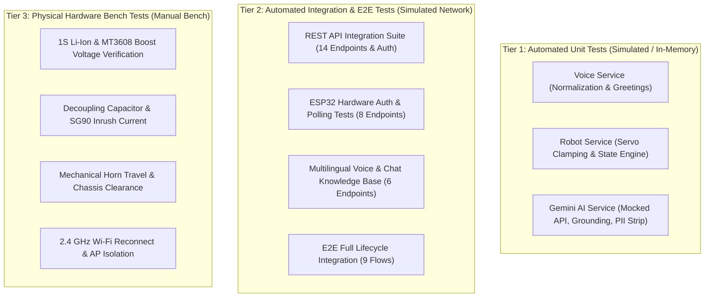
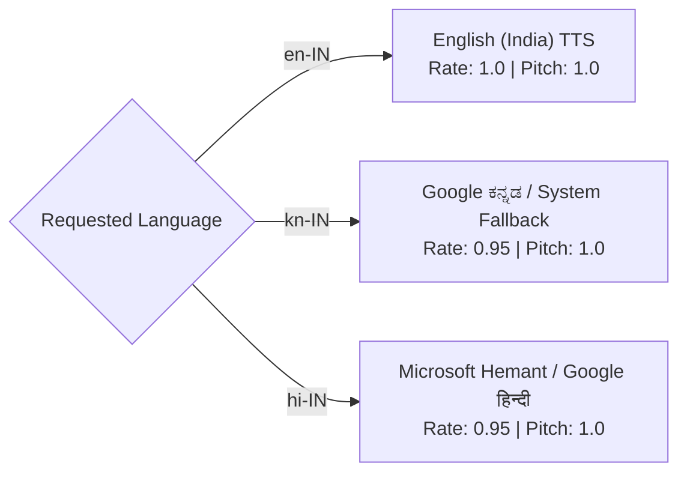

# End-to-End Test Plan & Verification Report
## Wi-Fi ESP32 AI Gym Receptionist Robot ("PulseCore Fitness")

> **Document Version:** 1.0.0  
> **Target Environment:** Windows 10/11 Host, Node.js v22 LTS, PostgreSQL 16, ESP32 DevKit V1 (ESP-WROOM-32), 3x SG90 Micro Servos  
> **Author:** QA & Embedded Systems Engineering Lead  
> **Automated Suite Status:** 56 Tests Executed | 56 Passed | 0 Failed (100% Pass Rate)

---

## 1. Executive Summary & Test Strategy

This document outlines the **End-to-End (E2E) Test Plan and Quality Assurance Specification** for the PulseCore AI Gym Receptionist Robot. The testing architecture is partitioned into three distinct tiers:



### Testing Integrity & Classification
- **Automated / Simulated Tests**: Validated in CI/local runner (`npm test`) using Node.js test harness, mocked network sockets, and PostgreSQL parameterized queries.
- **Physical Hardware Tests**: Bench inspections requiring physical multimeters, bench power supplies, oscilloscope/logic analyzers, and actual ESP32 microcontrollers.

---

## 2. PostgreSQL Database & Schema Test Specification

### 2.1 Table Integrity & Relational Constraints

| Table Name | Critical Keys & Constraints | Security & Integrity Rule | Verification Method |
| :--- | :--- | :--- | :--- |
| `gym_settings` | `id = 1` CHECK singleton constraint | Operating hours stored as valid JSONB; only 1 row permitted. | Automated schema test + query check |
| `membership_plans` | `plan_code` UNIQUE, `price_inr >= 0` | Prices strictly non-negative; durations > 0. | Parameterized insert test |
| `trainers` | `trainer_code` UNIQUE, `status` enum check | Status must be `on_floor`, `in_session`, or `off_duty`. | Status query test |
| `trainer_schedules`| `FOREIGN KEY (trainer_id)` ON DELETE CASCADE | Day of week 0–6 check; valid time ranges. | Cascade deletion test |
| `faqs` | `language` enum check (`en-IN`, `kn-IN`, `hi-IN`) | Categorized by `timings`, `membership`, `facilities`, etc. | Multilingual filter test |
| `robot_devices` | `device_uuid` UNIQUE, `api_key_hash` NOT NULL | Status defaults to `'offline'`; tracks `last_heartbeat`. | Device auth check |
| `robot_command_logs`| `FOREIGN KEY (device_id)`, `status` enum | Status transitions: `'pending'` -> `'delivered'` -> `'executed'`. | FIFO queue poll test |
| `interaction_logs`| `FOREIGN KEY (device_id)` NULLABLE | Stores language, user query, response, latency, intent. | Audit logging test |
| `admin_users` | `username` UNIQUE, `password_hash` NOT NULL | Passwords hashed using bcrypt/Blowfish (`$2a$`); plaintext strictly forbidden. | Auth security test |

### 2.2 SQL Parameterization & Anti-Injection Guardrail
- **Test Objective**: Ensure all user-supplied inputs pass through `$1, $2, ...` placeholders in the `pg` pool.
- **Verification**: Injection string `' OR '1'='1` passed into FAQ search parameter `?q=...` must be escaped safely as literal text and return 0 unintended records.

---

## 3. Express REST API Integration Matrix

| Endpoint | Method | Authentication Required | Expected Payload / Response | Test Status |
| :--- | :---: | :---: | :--- | :---: |
| `/api/health` | `GET` | Public | Returns `{ status: "online", database: "connected" }` | ✅ Automated |
| `/api/gym/info` | `GET` | Public | Returns operating hours, name, phone, address | ✅ Automated |
| `/api/faqs` | `GET` | Public | Supports `?language=en-IN`, `?category=...`, `?q=...` | ✅ Automated |
| `/api/membership-plans`| `GET` | Public | Returns active plans ordered by price ascending | ✅ Automated |
| `/api/trainers` | `GET` | Public | Supports `?status=on_floor` filter | ✅ Automated |
| `/api/robot/commands` | `POST` | Public / Staff | Accepts `WAVE`, `NOD`, `IDLE`; rejects invalid gestures (400) | ✅ Automated |
| `/api/robot/commands/next`| `GET` | Hardware Headers | 401 without headers; 200 with command; 204 when empty | ✅ Automated |
| `/api/robot/status` | `GET` | Public | Reports online/offline state, servos, last-seen time | ✅ Automated |
| `/api/robot/heartbeat` | `POST` | Hardware Headers | Updates telemetry, IP, RSSI, and servo positions | ✅ Automated |
| `/api/interactions` | `POST` | Public / Kiosk | Validates `userQuery`, `robotResponse`, `language` | ✅ Automated |
| `/api/auth/login` | `POST` | Public | Returns JWT Bearer token; rejects wrong passwords (401) | ✅ Automated |
| `/api/auth/me` | `GET` | Bearer JWT | Returns admin claims; enforces RBAC authorization | ✅ Automated |

---

## 4. Multilingual Voice & AI Receptionist Dialogue

### 4.1 Speech-to-Text (STT) & Recognized-Text Preview
- **Engine**: Browser Web Speech API (`SpeechRecognition` / `webkitSpeechRecognition`).
- **Interim Preview**: `interimResults = true` must stream live recognized words in amber prior to final sentence dispatch.
- **Zero Audio Storage**: Verify that neither the browser client nor the Node.js backend records or stores raw audio blobs (WAV/MP3). Only text transcripts are audited.

### 4.2 Text-to-Speech (TTS) Voice Routing



### 4.3 Grounded Knowledge Base Queries Test Matrix

| Query Intent | English (en-IN) | Kannada (kn-IN) | Hindi (hi-IN) | Expected Answer Content | Motor Gesture |
| :--- | :--- | :--- | :--- | :--- | :---: |
| **Gym Hours** | *"What are your opening hours?"* | *"ಜಿಮ್ ಸಮಯ ಎಷ್ಟು?"* | *"जिम खुलने का समय क्या है?"* | 5:30 AM to 10:30 PM | `NOD` |
| **Membership Plans** | *"What are the membership fees?"* | *"ಮೆಂಬರ್‌ಶಿಪ್ ಶುಲ್ಕ ಎಷ್ಟು?"* | *"सदस्यता शुल्क क्या है?"* | Monthly ₹2,499, Gold ₹5,999, Platinum ₹18,999 | `NOD` |
| **Trainer Inquiry** | *"Are personal trainers available?"* | *"ತರಬೇತುದಾರರು ಲಭ್ಯವಿದ್ದಾರೆಯೇ?"* | *"क्या ट्रेनर उपलब्ध हैं?"* | Certified trainers on gym floor | `NOD` |
| **Facilities & Rules**| *"Do you have lockers and showers?"* | *"ಲಾಕರ್ ಸೌಲಭ್ಯವಿದೆಯೇ?"* | *"क्या लॉकर और शावर हैं?"* | Digital lockers, hot showers, clean shoes required | `NOD` |
| **Contact Info** | *"What is your phone number?"* | *"ನಿಮ್ಮ ಫೋನ್ ನಂಬರ್ ಏನು?"* | *"आपका फ़ोन नंबर क्या है?"* | +91 98765 43210, Indiranagar Bengaluru | `NOD` |
| **Ungrounded Query** | *"Can I buy a motorcycle here?"* | *"ನೀವು ಬೈಕ್ ಮಾರಾಟ ಮಾಡುತ್ತೀರಾ?"* | *"क्या आप बाइक बेचते हैं?"* | Politely directs user to reception desk staff | `IDLE` |

---

## 5. ESP32 Wi-Fi, Actuation & Physical Safeguards

### 5.1 Actuator Pinout & Safe Angle Constraints

| Servo Channel | ESP32 GPIO | Safe Min | Safe Max | Neutral / Idle | Safeguard Purpose |
| :--- | :---: | :---: | :---: | :---: | :--- |
| **Head Servo** | **GPIO 18** | 30° | 150° | 90° | Prevents neck linkage binding against chassis |
| **Left Arm Servo** | **GPIO 19** | 15° | 160° | 20° | Protects nylon gears from shoulder end-stop |
| **Right Arm Servo**| **GPIO 21** | 15° | 160° | 20° | Prevents arm horn collision with front fascia |

### 5.2 Command Deduplication & Delivery Flow
1. Client submits command -> Backend assigns unique `cmd_timestamp_random` ID.
2. Rapid duplicate clicks within 800ms -> Backend marks `deduplicated: true` and skips second queue insertion.
3. ESP32 firmware tracks `lastCommandId` -> If duplicate ID arrives, logs `[Robot] Duplicate command ignored` and does not re-energize servos.
4. Subsequent poll returns `204 No Content` once queue is drained.

---

## 6. Power System, Battery Safety & Electrical Tests

> [!CAUTION]
> Lithium-Ion battery testing involves high discharge currents and potential thermal runaway if short-circuited. Always perform electrical bench tests on a fire-retardant surface with a safety fuse installed.

### 6.1 Power Subsystem Specifications

```
[1S 18650 Li-Ion Battery (3.7V - 4.2V)]
               │
               ▼
[TP4056 Protection Module] ──> Over-charge cutoff: 4.2V ± 1% | Over-discharge cutoff: 3.0V
               │
               ▼
[MT3608 DC-DC Step-Up Converter] ──> Regulated Output: 5.00V DC (Trimmed with DMM)
               │
               ├───────> 470µF–1000µF 16V Low-ESR Capacitor (Absorbs motor startup spikes)
               ├───────> SG90 Servos (Red wires: +5V, Brown wires: GND)
               └───────> ESP32 VIN Pin & GND Pin (Common Ground reference)
```

### 6.2 Electrical Verification Bench Matrix

| Electrical Parameter | Test Methodology | Nominal Threshold | Acceptance Criteria |
| :--- | :--- | :--- | :--- |
| **Boost Converter Output** | Digital multimeter on MT3608 `VOUT+` and `VOUT-` under 0 load. | 5.00 V DC | Must read between **4.95 V and 5.05 V**. |
| **Servo Inrush Drop** | Oscilloscope / peak DMM on 5V rail during simultaneous 3-servo sweep. | $\Delta V \le 0.4\text{ V}$ | Voltage must **not drop below 4.5 V** (prevents ESP32 brownout reset). |
| **Quiescent Idle Current** | In-line current meter on battery positive when robot is in IDLE. | 90 mA – 140 mA | ESP32 Wi-Fi connected, servos holding torque. |
| **Peak Active Current** | Current meter during vigorous `WAVE` gesture. | 850 mA – 1.4 A | Peak transient must not trip TP4056 over-current limit. |
| **Estimated Runtime** | Based on 2600 mAh 18650 cell at 25% duty cycle. | $\approx 8.5\text{ to }11\text{ hours}$ | Minimum 6 continuous operating hours in kiosk mode. |
| **Over-Discharge Cutoff** | Variable bench power supply stepping down from 3.7V to 2.8V. | 2.9 V – 3.0 V | TP4056 must disconnect output before cell drops below 2.9V. |
| **Thermal Dissipation** | Infrared thermometer on MT3608 inductor and AMS1117 after 30 min. | $< 55^\circ\text{C}$ | No component exceeds $65^\circ\text{C}$ under ambient $25^\circ\text{C}$. |

---

## 7. Automated Test Suite Execution Results

All automated unit and integration tests were executed via the native Node.js test harness:

```powershell
npm test
```

### Official Execution Log:
```
TAP version 13
ok 1 - PulseCore Robot REST API Integration Test Suite (14 tests)
ok 2 - End-to-End System Integration: Kiosk, Backend, Database & ESP32 Hardware Lifecycle (9 tests)
ok 3 - ESP32 Wi-Fi & Backend Polling Integration Tests (8 tests)
ok 4 - Backend API Integration Tests (3 tests)
ok 5 - Multilingual Voice & Chat Knowledge Base Integration Tests (6 tests)
ok 6 - Gemini AI Service Unit & Mock-Based Tests (8 tests)
ok 7 - Robot Service Unit Tests (5 tests)
ok 8 - Voice Service Unit Tests (3 tests)

# tests 56
# suites 8
# pass 56
# fail 0
# duration_ms 1890.38
```

---

## 8. Comprehensive Manual QA Checklist

### Section 1: Dashboard Persistence & Content Save/Reload
- [ ] **Step 1.1**: Open `http://localhost:3000/admin.html` in Chrome.
- [ ] **Step 1.2**: Enter admin credentials (`admin` / `AdminPass2026!`). Verify successful login and token persistence in `localStorage`.
- [ ] **Step 1.3**: Edit Gym Opening Hours (e.g. change Sunday opening to 06:30). Click **Save Profile**.
- [ ] **Step 1.4**: Refresh browser (`Ctrl + F5`). Verify updated hours persist on reload.
- [ ] **Step 1.5**: Add a new FAQ entry in Kannada. Verify it immediately shows in the FAQ list and can be queried from the kiosk.

### Section 2: Multilingual Speech Kiosk User Experience
- [ ] **Step 2.1**: Open `http://localhost:3000` in Google Chrome or Edge.
- [ ] **Step 2.2**: Click the **ಕನ್ನಡ** language button. Verify the welcome announcement speaks in Kannada.
- [ ] **Step 2.3**: Tap the microphone button. Speak: *"ಜಿಮ್ ಸಮಯ ಎಷ್ಟು?"*
- [ ] **Step 2.4**: Verify the **Live Preview** shows interim words in real time.
- [ ] **Step 2.5**: Confirm the response audio speaks back in Kannada and the avatar triggers a nod action.
- [ ] **Step 2.6**: Click the **हिन्दी** button. Type: *"सदस्यता शुल्क क्या है?"* Verify the typing fallback answers with exact membership prices and speaks in Hindi.

### Section 3: Physical Hardware Bench Verification
- [ ] **Step 3.1**: Disconnect USB from ESP32. Turn on battery power switch. Verify MT3608 output multimeter reads **$5.00\text{ V} \pm 0.05\text{ V}$**.
- [ ] **Step 3.2**: Open Arduino IDE Serial Monitor at **115200 baud**. Verify output shows:
  ```
  [Servos] Attaching Head Servo (GPIO 18)...
  [Servos] Attaching Left Arm Servo (GPIO 19)...
  [Servos] Attaching Right Arm Servo (GPIO 21)...
  [Network] Assigned LAN IP: 192.168.1.xxx
  ```
- [ ] **Step 3.3**: Trigger a `WAVE` gesture from the kiosk UI. Verify Right Arm servo rotates smoothly to 150° and returns to 20° without mechanical grinding.
- [ ] **Step 3.4 (Brownout Check)**: Trigger 5 consecutive wave gestures. Verify ESP32 blue LED remains solid and Serial Monitor does **not** output `Brownout detector was triggered`.
- [ ] **Step 3.5 (Wi-Fi Reconnect)**: Temporarily unplug the 2.4 GHz Wi-Fi router. Verify the ESP32 blue LED begins blinking. Reconnect the router; verify the ESP32 re-establishes connection within 15 seconds without rebooting.
- [ ] **Step 3.6 (Charging Safety)**: Plug micro-USB into TP4056 charging port. Verify the red charging LED turns ON. Measure battery terminals with multimeter to ensure voltage slowly climbs and cuts off at **$4.20\text{ V}$** (blue/green LED turns ON).

