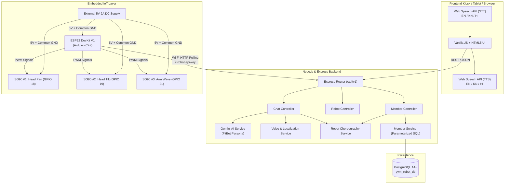

# System Architecture: Wi-Fi ESP32 AI Gym Receptionist Robot

## High-Level System Architecture

## Core Subsystems

### 1. Embedded Hardware Subsystem (ESP32)
- **Controller**: DOIT ESP32 DevKit V1 running an asynchronous-friendly Arduino C++ firmware loop.
- **Actuators**: 3x SG90 micro servos handling Head Pan (Yaw), Head Tilt (Pitch), and Right Arm (Greeting Wave).
- **Network Link**: Dedicated 2.4 GHz 802.11 b/g/n Wi-Fi with automatic reconnection logic.
- **Communication Protocol**: HTTP polling of pending queued motion steps with an authorization header (`x-robot-api-key`) and periodic heartbeat reporting.

### 2. Backend Orchestration Layer (Node.js & Express)
- **Modular ES Modules**: Clean separation of Routes, Controllers, Services, Middlewares, and Configuration.
- **Security**: Pre-shared API Key header validation for IoT endpoints; parameterized queries for database protection.
- **Robot Choreography Engine**: Maintains queued gestures (`GREET_WAVE`, `NOD_YES`, `SHAKE_NO`, etc.) with angle limits to protect SG90 gears.
- **Multi-Language Support**: Handles English (`en-IN`), Kannada (`kn-IN`), and Hindi (`hi-IN`).

### 3. Database Layer (PostgreSQL)
- Relational schema modeling gym members, visit check-ins, robot movement telemetry logs, and conversational dialogue audit logs.
- Automatic failover to an in-memory mock store if PostgreSQL is temporarily unavailable during initial local frontend/firmware development.

### 4. Frontend Receptionist Interface
- Zero-dependency Vanilla JavaScript (ES modules), HTML5, and CSS3.
- Integrated Web Speech API for bi-directional voice conversation.
- Live hardware telemetry panel showing ESP32 IP and servo angle meters.

