# Virtex Trainer Hub — Data Model Extension

Status: **PROPOSED — not executed.** Migration files: `database/migrations/trainer_hub/`
(001–010 with matching `_down.sql`; see its README for order and rollback).

## 1. Design principles

| Decision | Rationale |
|---|---|
| **Reuse first.** No new trainer, member, workout, diet, recovery or measurement tables. | All of these already exist (see §2). |
| **Primary keys:** `BIGINT GENERATED ALWAYS AS IDENTITY` + `public_id UUID DEFAULT gen_random_uuid()` on API-exposed new tables. | Every existing table uses integer `SERIAL` keys and all new tables reference `members.id` / `trainers.id` (INTEGER). UUID PKs would mix key types; a separate `public_id` gives non-guessable external IDs. |
| **Timestamps:** `created_at` / `updated_at TIMESTAMPTZ`, `updated_at` maintained by the existing `fn_update_timestamp()` trigger. | Matches existing convention. |
| **Archival:** status columns + `archived_at` (packages, threads, notifications), `deleted_at` (messages). | Records are retired, not deleted. Existing `is_active` columns are untouched. |
| **History:** assignment changes and every session-balance movement are written to append-only tables. | `personal_trainer_assignments` and `pt_package_purchases` only hold current state. |
| **Member deletion:** new member-owned rows use `ON DELETE CASCADE`. | Matches all 30 existing member-child tables; `RESTRICT` would break the existing "Delete member" feature. History tables use `SET NULL` so they survive trainer/assignment removal. |
| **Balance safety:** balances change only through `fn_pt_complete_session()` / `fn_pt_reverse_session()`, which lock the purchase row (`SELECT … FOR UPDATE`) inside one transaction. | Prevents double deduction and overdraw under concurrent requests. |
| **Additive only:** `CREATE … IF NOT EXISTS`, `ADD COLUMN IF NOT EXISTS` (all nullable or defaulted). | No drops, renames, type changes or data rewrites. |

## 2. Reuse map

| Area | Requirement | Existing table(s) — reused as-is | Change |
|---|---|---|---|
| A | Trainer profiles | `trainers` | index on `user_id` |
| A | Member profiles | `members` | — |
| A | Assignments + status | `personal_trainer_assignments` (`status` ∈ active/paused/completed/cancelled) | unique active pair; 2 nullable cols |
| A | Assignment history | — | **NEW `pt_assignment_history`** (trigger-fed) |
| B | PT packages | — (finance "packages" = `membership_plans`) | **NEW `pt_packages`** |
| B | Session balances | — | **NEW `pt_package_purchases`** (generated `sessions_remaining`) + **NEW `pt_session_balance_ledger`** |
| B | Bookings / records / completion | — | **NEW `pt_sessions`** (one row from booking to outcome) |
| C | Programmes / days / exercises | `workout_programs`, `workout_program_days`, `workout_program_exercises` | `archived_at` on programmes |
| C | Exercise library | `exercises` | `archived_at` |
| C | Workout assignments | `member_workout_assignments` | index on `assigned_by_trainer_id` |
| C | Daily logs / sets & reps | `workout_session_logs`, `workout_session_items` | `trainer_id` on logs |
| D | Diet plans / meal plans / foods | `diet_plans`, `diet_plan_meals`, `diet_plan_meal_items`, `food_items` | `archived_at` on plans & foods |
| D | Diet assignments / nutrition logs | `member_diet_assignments`, `member_nutrition_daily_logs`, `member_nutrition_meal_entries` | index on `assigned_by_trainer_id` |
| E | Strength records | `member_strength_logs` | — |
| E | Cardio benchmarks | — | **NEW `member_cardio_benchmarks`** |
| E | Body measurements | `member_body_measurements`, `member_transformation_photos` | — |
| E | Progress history | `member_performance_profiles` holds only the *current* row | **NEW `member_progress_snapshots`** |
| E | Trainer feedback | `member_trainer_comments`, `trainer_recovery_reviews` | index on `member_trainer_comments.trainer_id` |
| F | Recovery / sleep / rest days | `member_recovery_logs` (sleep_hours, sleep_quality, is_rest_day, rest_day_activity…) | — |
| F | Soreness | `member_muscle_soreness_details` | — |
| G | Trainer–member messages | — (VIRTEX Message is browser-only) | **NEW `message_threads`, `messages`** |
| G | Notifications + read status | — (`announcements` are gym-wide, not per user) | **NEW `notifications`** |

**New tables: 9.** Everything else is reuse.

## 3. ER diagram

```mermaid
erDiagram
    users ||--o| trainers : "trainers.user_id"
    users ||--o| members : "users.member_id"

    members ||--o{ personal_trainer_assignments : has
    trainers ||--o{ personal_trainer_assignments : coaches
    personal_trainer_assignments ||--o{ pt_assignment_history : "audited by"

    pt_packages ||--o{ pt_package_purchases : "sold as"
    members ||--o{ pt_package_purchases : buys
    personal_trainer_assignments |o--o{ pt_package_purchases : "linked to"
    pt_package_purchases ||--o{ pt_session_balance_ledger : "balance moves"
    pt_package_purchases |o--o{ pt_sessions : "consumed by"
    trainers ||--o{ pt_sessions : runs
    members ||--o{ pt_sessions : attends
    pt_sessions |o--o| workout_session_logs : "records workout"
    pt_sessions |o--o{ pt_session_balance_ledger : "deducts"

    workout_programs ||--o{ workout_program_days : contains
    workout_program_days ||--o{ workout_program_exercises : lists
    exercises ||--o{ workout_program_exercises : "used in"
    members ||--o{ member_workout_assignments : "assigned"
    workout_programs ||--o{ member_workout_assignments : "assigned as"
    members ||--o{ workout_session_logs : logs
    trainers |o--o{ workout_session_logs : supervises
    workout_session_logs ||--o{ workout_session_items : "sets & reps"

    diet_plans ||--o{ diet_plan_meals : has
    diet_plan_meals ||--o{ diet_plan_meal_items : contains
    food_items ||--o{ diet_plan_meal_items : "used in"
    members ||--o{ member_diet_assignments : follows
    members ||--o{ member_nutrition_daily_logs : logs

    members ||--o{ member_strength_logs : lifts
    members ||--o{ member_cardio_benchmarks : tests
    members ||--o{ member_body_measurements : measured
    members ||--o{ member_progress_snapshots : "progress over time"
    members ||--o{ member_trainer_comments : "receives feedback"
    members ||--o{ member_recovery_logs : "recovery / sleep / rest"
    member_recovery_logs ||--o{ member_muscle_soreness_details : soreness

    trainers ||--o{ message_threads : "chats in"
    members ||--o{ message_threads : "chats in"
    message_threads ||--o{ messages : contains
    users ||--o{ messages : sends
    users ||--o{ notifications : receives
```



## 4. New entities

| Table | Purpose | Key constraints |
|---|---|---|
| `pt_packages` | Sellable PT products (e.g. 12 sessions / 60 days / ₹9,000). | `package_code` unique; sessions > 0; validity > 0; price ≥ 0; `archived_at` instead of delete (`RESTRICT` from purchases). |
| `pt_package_purchases` | A member's balance on one package. Snapshots sessions/price at purchase time. | `0 ≤ sessions_used ≤ sessions_total`; `sessions_remaining` is a **generated column**; `valid_until ≥ valid_from`; status ∈ active/exhausted/expired/cancelled/refunded. |
| `pt_session_balance_ledger` | Append-only history of every balance change. | `delta ≠ 0`; reason enum; **one deduction per session** (partial unique on `(session_id)` for deductions). |
| `pt_sessions` | A PT session from booking through outcome. | `scheduled_end > scheduled_start`; status ∈ booked/confirmed/completed/cancelled/no_show; completed ⇒ `completed_at`; cancelled ⇒ `cancelled_at`; no trainer double-booking at the same start time (partial unique). |
| `pt_assignment_history` | Who changed which assignment, when, from→to. | Filled by trigger on `personal_trainer_assignments`; FKs `SET NULL` so history survives deletions. |
| `member_cardio_benchmarks` | Run/row/bike/VO₂/HR tests. | test type enum; value ≥ 0; indexed by member + date. |
| `member_progress_snapshots` | Point-in-time copy of performance metrics. | one snapshot per member per day; percentages 0–100. |
| `message_threads` | One conversation per trainer–member pair. | unique `(trainer_id, member_id)`; status active/archived. |
| `messages` | Messages with read status and soft delete. | body 1–4000 chars; sender role enum; `read_at`, `deleted_at`. |
| `notifications` | Per-user inbox with read status. | type enum; index on unread per recipient. |

## 5. Session-balance transaction flow

```
fn_pt_complete_session(session_id, outcome ['completed'|'no_show'], user_id, charge_no_show)
  1. SELECT session … FOR UPDATE           -- lock the session
  2. reject if already completed/no_show/cancelled
  3. if session has a purchase AND (completed OR charge_no_show):
       SELECT purchase … FOR UPDATE         -- lock the balance row
       reject if purchase not active, expired (valid_until < today), or sessions_remaining = 0
       UPDATE purchase SET sessions_used += 1, status = 'exhausted' when it hits 0
       INSERT ledger (delta -1, reason, balance_after)
  4. UPDATE session SET status, completed_at, balance_deducted
  All in one transaction; any failure rolls back everything.

fn_pt_reverse_session(session_id, user_id, reason)
  Locks session + purchase, gives the session back (+1), writes a ledger row,
  reopens an 'exhausted' purchase, marks the session cancelled.
```

The CHECK `sessions_used <= sessions_total` is the final guard: even a direct UPDATE cannot overdraw a balance.

## 6. Existing-table changes (all additive)

| Table | Change |
|---|---|
| `personal_trainer_assignments` | `+ package_id` (nullable → pt_packages), `+ updated_by_user_id` (nullable → users); partial unique: one **active** assignment per (member, trainer). |
| `workout_session_logs` | `+ trainer_id` (nullable → trainers, SET NULL) |
| `workout_programs`, `exercises`, `diet_plans`, `food_items` | `+ archived_at TIMESTAMPTZ` (nullable) |
| Indexes | `trainers(user_id)`, `member_workout_assignments(assigned_by_trainer_id)`, `member_diet_assignments(assigned_by_trainer_id)`, `member_trainer_comments(trainer_id)`, `online_classes(instructor_trainer_id)`, `workout_session_logs(trainer_id)` |

## 7. Rollback

Each `trainer_hub/NNN_*_down.sql` drops only what its up-script creates; run them in reverse order (010 → 001). **Rolling back deletes data stored in the new tables** — take a backup first.

## 8. Before executing (needs approval)

1. Back up the database (`scripts\backup_db.ps1`).
2. Dry run each file: `BEGIN; \i trainer_hub/NNN_….sql; ROLLBACK;`
3. Execute, then re-run the read-only schema audit.
4. Not covered by this migration (code changes): trainer data scoping middleware, Trainer Hub API endpoints, the `admin_users` login fallback and the `/auth/register` role check.
